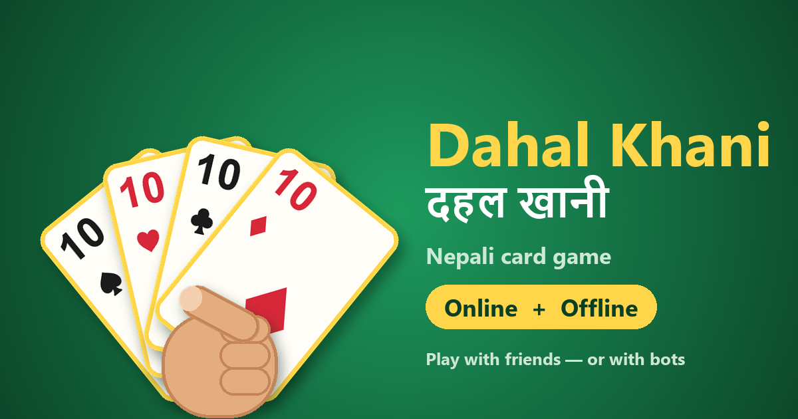

# Dahal Khani (Dahal Mara / Dahal Jeet)

<p align="center">
  <a href="https://king55-hack.github.io/dahal-khani/"></a>
</p>

<p align="center"><b><a href="https://king55-hack.github.io/dahal-khani/">▶ Play now / Khelnus</a></b></p>

Traditional Nepali 4-player card game (2 teams, like Mendikot / Dehla Pakad), as a browser prototype.
Play **offline** against 3 bots (partner Sita; opponents Gajendra and Ranjana) or **online** with friends
(rooms with optional password; bots fill empty seats).
Works on phones (portrait and landscape).

Features: 4 languages (नेपाली, Nepali Roman, English, 日本語), 3 trump modes (Normal, Band hukum,
Cut hukum), 3 bot levels (Easy / Medium / Hard), coins for winning rounds (and lost coins when you are Kot'd or Baunne'd while holding 50+), unlockable card designs, table backgrounds (Normal, Gundri
straw mat, Galaicha carpet), sound on/off — all in ⚙ Settings. Installable on phones (Add to Home Screen)
and playable offline after the first visit.

**Play online:** https://king55-hack.github.io/dahal-khani/

Created by **Rajan Rimal**.

## Run locally

```
npm install
npm run dev      # open http://localhost:5173
npm test         # rules-engine unit tests
npm run build    # production build in dist/
```

## Online play (friends + bots)

🌐 in the header → pick a room from **Open rooms**, join with a **6-digit room number + password**, or
create your own room (with a password = private 🔒, without = public). Empty seats are filled by bots,
the host picks the mode and starts. Every move is checked on the server, each player only receives
their own cards, and room passwords are stored only as salted PBKDF2 hashes (10 wrong tries per
10 minutes per room).

The room server is a Cloudflare Worker + Durable Objects (free plan) in `server/worker.ts`; the room
logic itself is plain TypeScript in `src/online/` and is unit-tested.

```
npm run server:dev                  # local server on :8787 (the dev site uses it automatically)
node scripts/online-smoke.mjs       # end-to-end test against it
npx wrangler login                  # once, opens Cloudflare in the browser
npm run server:deploy               # prints https://dahal-khani.<account>.workers.dev
gh variable set SERVER_URL --body https://dahal-khani.<account>.workers.dev
```

After `SERVER_URL` is set, the next GitHub Pages deploy shows the 🌐 button on the live site.
Allowed sites are set in `wrangler.jsonc` (`ALLOWED_ORIGINS`).

## Project layout

- `src/engine/` — pure rules engine (no UI): dealing, TURUP, legal moves, Haat, Dahal, scoring, bots,
  and per-player views (no peeking at other hands).
- `src/online/` — room logic and message format shared by browser and server.
- `server/` — Cloudflare Worker / Durable Object glue.
- `src/ui/` — browser UI only: `i18n.ts` (all text, 4 languages), `modals.ts` (settings / info /
  language dialogs), `themes.ts` (card designs and prices), `sound.ts`, `prefs.ts` (saved in the browser).
- `src/settings.ts` — point values, coin rewards, default trump mode, bot speed, creator name.
- Debug: add `?autoplay` to the URL to watch bots play every seat; in `npm run dev`, `?result=kot-lose` (or `baunne-win`, `normal-win`, …) previews a result screen.

## Bot levels (⚙ Settings → Bot level, offline games)

- **Easy** — simple rules of thumb (the original bot).
- **Medium** — guesses who holds which cards by dealing the unseen cards out at random and playing each of
  its options to the end of the round in every guess, but only remembers the last 3 tricks (plus which 10s are gone).
- **Hard** — same look-ahead with a perfect memory of every card played, it notices who has run out of a suit
  and uses that in its guesses (about 200 guessed deals per move, a fraction of a second).

The bots never look at your hand: they only use the cards they can see, the hand sizes and the suits players
failed to follow (`src/engine/smart-bot.ts`, with a test that shuffling the other hands changes nothing).
In online rooms the host picks the bot level in the lobby before starting (default Easy). Online bots use fewer guessed deals (8 / 24) so the free Cloudflare plan's CPU limit is respected. Coin penalty values are in `COIN_PENALTIES` (`src/settings.ts`).

## Rules (short)

- 5 cards each → the player after the dealer picks **TURUP** (trump) → 4 + 4 more cards each.
- Follow the led suit if you can; otherwise play anything. Highest trump wins, else highest of the led suit.
- Capture 3 or 4 **Dahal** (10s) to win the round; at 2–2 the team with more **Haat** (tricks) wins.
- **Kot** = all four 10s, **Baunne** = all 13 tricks.

## Copyright

© 2026 Rajan Rimal. All rights reserved.
The source code is public so it can be read, but no licence is granted to copy, modify or redistribute it.
